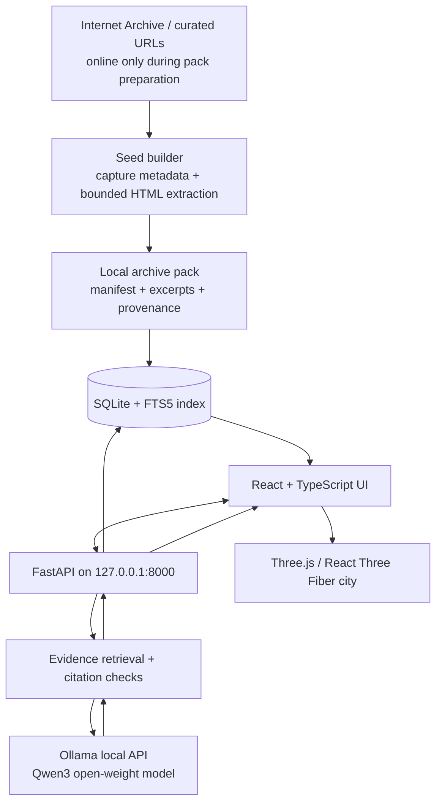

# Technical Architecture

## AFTERWEB: Local-First System Architecture

### Components

1. **Frontend (Vite + React 19 + TypeScript)**:
   * **3D Canvas**: React Three Fiber 9 + Drei for rendering buildings, districts, and observed routes.
   * **2D Fallback**: Complete list and graph representation for accessibility and low-spec machines.
   * **State Management**: Zustand store tracking selected node, camera view, inspector drawer, and chat.
   * **CSS Modules**: Custom retro-observatory theme tokens (warm amber observed routes, teal captures, gray ghost plots).

2. **Backend (FastAPI + Python 3.11)**:
   * REST endpoints on `127.0.0.1:8000`.
   * `archive_client`: Controlled, rate-limited CDX API and capture fetcher with host allowlist.
   * `extractor`: BeautifulSoup parser extracting clean text chunks and valid `href` anchors.
   * `retrieval`: SQLite FTS5 lexical search matching questions against curated chunks.
   * `ollama_client`: Communicates strictly with loopback `http://127.0.0.1:11434`.
   * `chat_service`: Constructs bounded prompt payloads, enforces untrusted content safety, and validates citations.

3. **Storage (SQLite + FTS5)**:
   * Single file at `data/local/afterweb.db`.
   * Tables: `sites`, `captures`, `pages`, `chunks`, `link_edges`, and FTS5 virtual tables.
